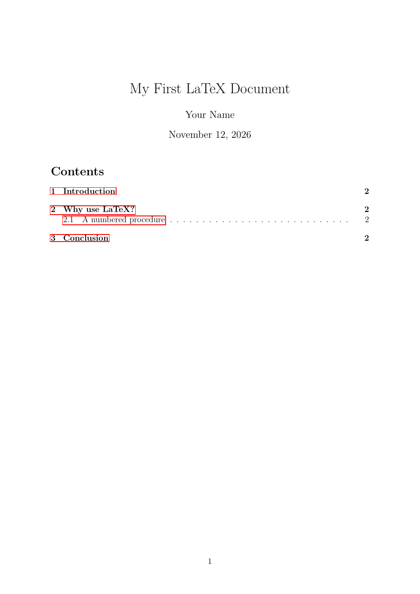

# 01 | First LaTeX Document

> **Start with the structure of a LaTeX file.**

---

## 01. What You Will Learn

- The purpose of `\documentclass`.
- The preamble and packages.
- Title, author and date.
- The document environment.
- Sections, subsections and a table of contents.
- Bulleted and numbered lists.

## 02. Understand the Structure

A LaTeX document has two main parts:

1. **Preamble:** document class, packages and document settings.
2. **Document body:** the text, sections, lists, equations and other content.

```latex
\documentclass{article}
\usepackage{amsmath}

\begin{document}
\section{Introduction}
Hello, LaTeX!
\end{document}
```

## 03. Compile the Example

```bash
pdflatex main.tex
```

Open `main.tex`, change the title or add a new section, then compile again.

## 04. Output Preview



*Rendered from this folder's `main.tex` using pdfLaTeX.*

---

[Back to LaTeX](../README.md) · [Next: Page Layout](../02-page-layout/README.md)
