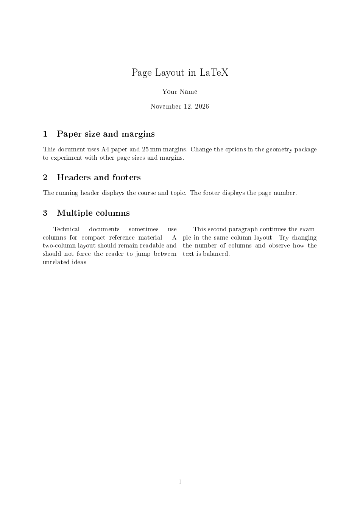

# 02 | Page Layout

> **Control how content fits on each page.**

---

## 01. What You Will Learn

- Paper size and page margins with `geometry`.
- Headers and footers with `fancyhdr`.
- Landscape pages with `pdflscape`.
- Multiple columns with `multicol`.
- Page numbering.

## 02. Important Packages

| Package | Purpose |
|---|---|
| `geometry` | Sets page size and margins |
| `fancyhdr` | Customises headers and footers |
| `pdflscape` | Rotates selected pages to landscape |
| `multicol` | Divides text into columns |

## 03. Compile the Example

```bash
pdflatex main.tex
```

Try changing the margin value, header text or number of columns. The source also includes a landscape page with a table.

## 04. Output Preview



*Rendered from this folder's `main.tex` using pdfLaTeX.*

---

[Back: First Document](../01-first-document/README.md) · [Back to LaTeX](../README.md) · [Next: Formatting](../03-formatting/README.md)
