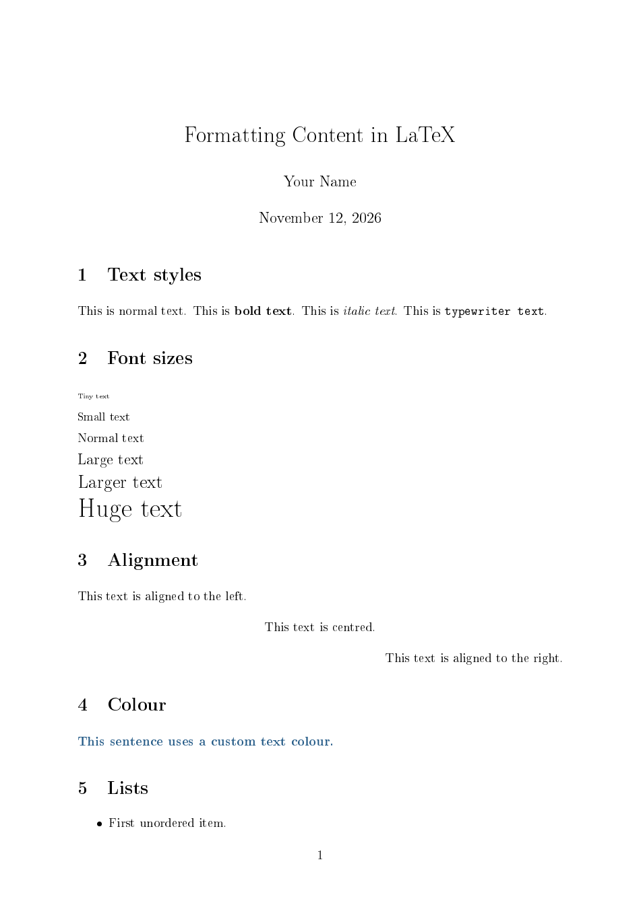

# 03 | Formatting Content

> **Give text a clear and consistent appearance.**

---

## 01. What You Will Learn

- Bold, italic and typewriter text.
- Font size commands.
- Left, centre and right alignment.
- Text colour using `xcolor`.
- Bulleted and numbered lists.
- Paragraph spacing.

## 02. Common Formatting Commands

| Command | Purpose |
|---|---|
| `\textbf{...}` | Bold text |
| `\textit{...}` | Italic text |
| `\texttt{...}` | Typewriter / monospaced text |
| `\small`, `\large`, `\huge` | Change font size |
| `\textcolor{blue}{...}` | Apply a text colour |
| `itemize` | Unordered list |
| `enumerate` | Numbered list |

## 03. Compile the Example

```bash
pdflatex main.tex
```

Open the source and change the styles or colour to see how the PDF changes.

## 04. Output Preview



*Rendered from this folder's `main.tex` using pdfLaTeX.*

---

[Back: Page Layout](../02-page-layout/README.md) · [Back to LaTeX](../README.md) · [Next: Mathematics](../04-mathematics/README.md)
