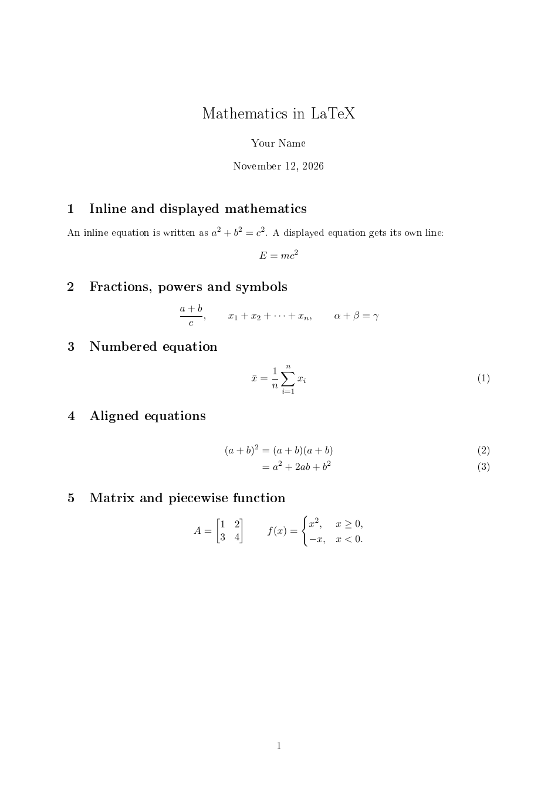

# 04 | Mathematics

> **Typeset mathematical expressions clearly.**

---

## 01. What You Will Learn

- Inline and displayed equations.
- Fractions, exponents and subscripts.
- Greek letters and common symbols.
- Aligned equations.
- Matrices and piecewise functions.

## 02. Common Mathematical Syntax

| Expression | LaTeX syntax |
|---|---|
| (a^2) | `a^2` |
| (rac{a}{b}) | `\frac{a}{b}` |
| (sqrt{x}) | `\sqrt{x}` |
| (sum_{i=1}^{n} i) | `\sum_{i=1}^{n} i` |
| (alpha,eta,gamma) | `\alpha,\beta,\gamma` |

Use `$...$` or `\(...\)` for inline mathematics and `\[...\]` for a displayed equation. The example also shows `align`, `bmatrix` and `cases`.

## 03. Compile the Example

```bash
pdflatex main.tex
```

Try changing the equation or adding another mathematical expression.

## 04. Output Preview



*Rendered from this folder's `main.tex` using pdfLaTeX.*

---

[Back: Formatting](../03-formatting/README.md) · [Back to LaTeX](../README.md) · [Next: Tables and Images](../05-tables-and-images/README.md)
