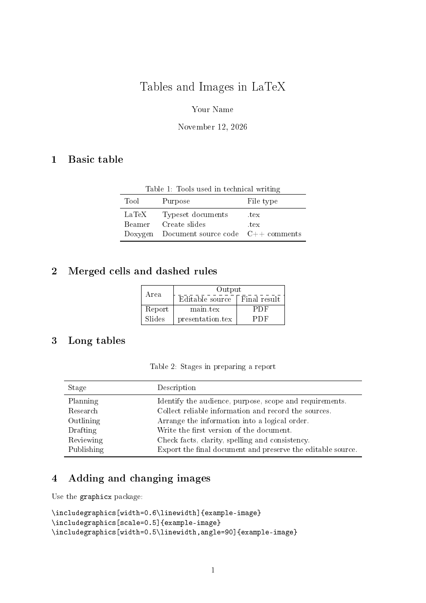

# 05 | Tables and Images

> **Present structured information and visual examples.**

---

## 01. What You Will Learn

- Creating a basic table.
- Horizontal and vertical rules.
- Merging columns with `\multicolumn` and rows with `multirow`.
- Dashed rules with the `arydshln` package.
- Long tables that continue across pages.
- Adding, scaling and rotating images with `graphicx`.

## 02. Useful Packages

| Package | Purpose |
|---|---|
| `booktabs` | Clean horizontal table rules |
| `multirow` | Merge cells vertically |
| `arydshln` | Create dashed table rules |
| `longtable` | Tables that span multiple pages |
| `graphicx` | Insert, scale and rotate images |

## 03. Image Commands

```latex
\includegraphics[width=0.6\linewidth]{image.png}
\includegraphics[scale=0.5]{image.png}
\includegraphics[width=0.5\linewidth,angle=90]{image.png}
```

## 04. Compile the Example

```bash
pdflatex main.tex
```

The source includes examples of merged cells, dashed rules, a multi-page table and a framed placeholder for an image.

## 05. Output Preview



*Rendered from this folder's `main.tex` using pdfLaTeX.*

---

[Back: Mathematics](../04-mathematics/README.md) · [Back to LaTeX](../README.md) · [Next: Cross-References](../06-cross-references/README.md)
