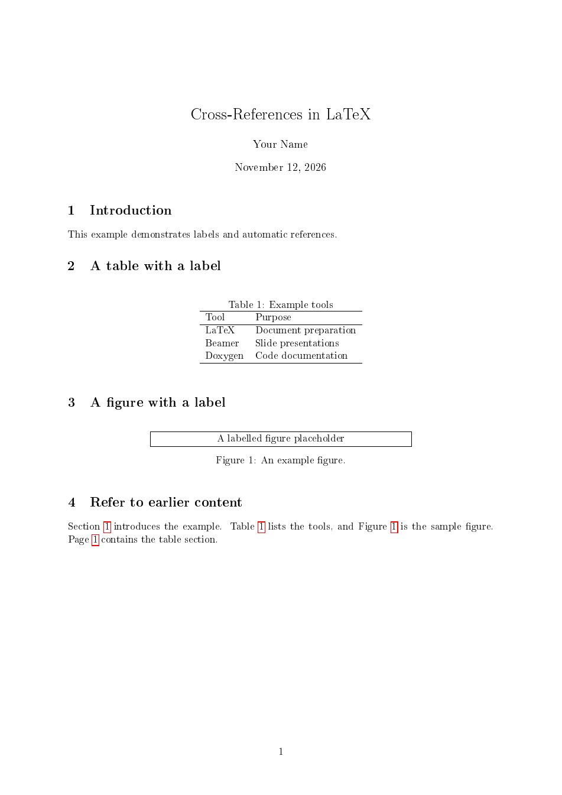

# 06 | Cross-References

> **Let LaTeX manage numbers and page references for you.**

---

## 01. What You Will Learn

- Creating a label with `\label{...}`.
- Referring to a label with `\ref{...}`.
- Using `\pageref{...}` to show a page number.
- Labelling figures, tables and equations.
- Hyperlinks with the `hyperref` package.

## 02. The Basic Pattern

```latex
\section{Introduction}\label{sec:introduction}

See Section~\ref{sec:introduction}.
```

Place a label after the section title or figure/table caption. LaTeX updates the number when the document structure changes.

## 03. Compile the Example

```bash
pdflatex main.tex
pdflatex main.tex
```

LaTeX may need another compilation pass to update reference numbers. Change a section title or add a section to see how the references update automatically.

## 04. Output Preview



*Rendered from this folder's `main.tex` using pdfLaTeX.*

---

[Back: Tables and Images](../05-tables-and-images/README.md) · [Back to LaTeX](../README.md) · [Next: Bibliography](../07-bibliography/README.md)
