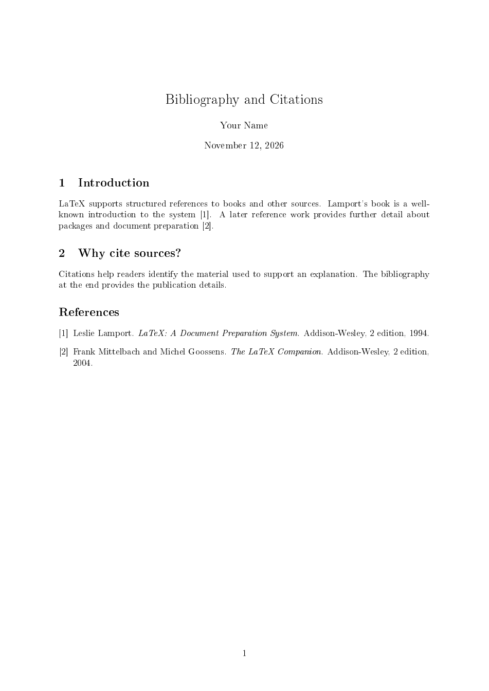

# 07 | Bibliography and Citations

> **Give credit to the sources used in a document.**

---

## 01. What You Will Learn

A bibliography lists the sources used in a document. This example uses BibTeX with the `natbib` package.

## 02. Important Commands

- `\citep{key}` — parenthetical citation.
- `\citet{key}` — author-focused citation.
- `\bibliographystyle{plainnat}` — selects a bibliography style.
- `\bibliography{references}` — loads `references.bib`.

The citation key in the source file must match the key in the BibTeX file exactly.

## 03. Build Sequence

Run these commands from this folder:

```bash
pdflatex main.tex
bibtex main
pdflatex main.tex
pdflatex main.tex
```

The extra LaTeX passes resolve citations and bibliography references.

## 04. Output Preview



*Rendered from this folder's `main.tex` after the BibTeX build sequence.*

---

[Back: Cross-References](../06-cross-references/README.md) · [Back to LaTeX](../README.md) · [Next: Index](../08-index/README.md)
