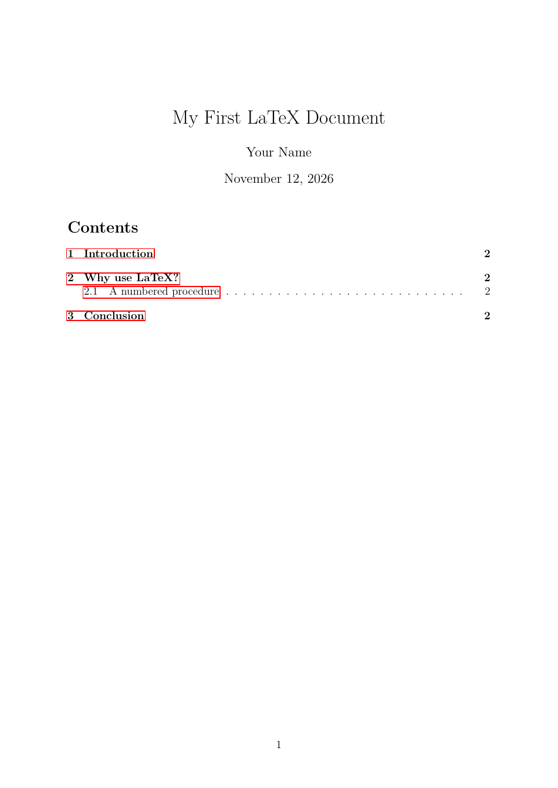
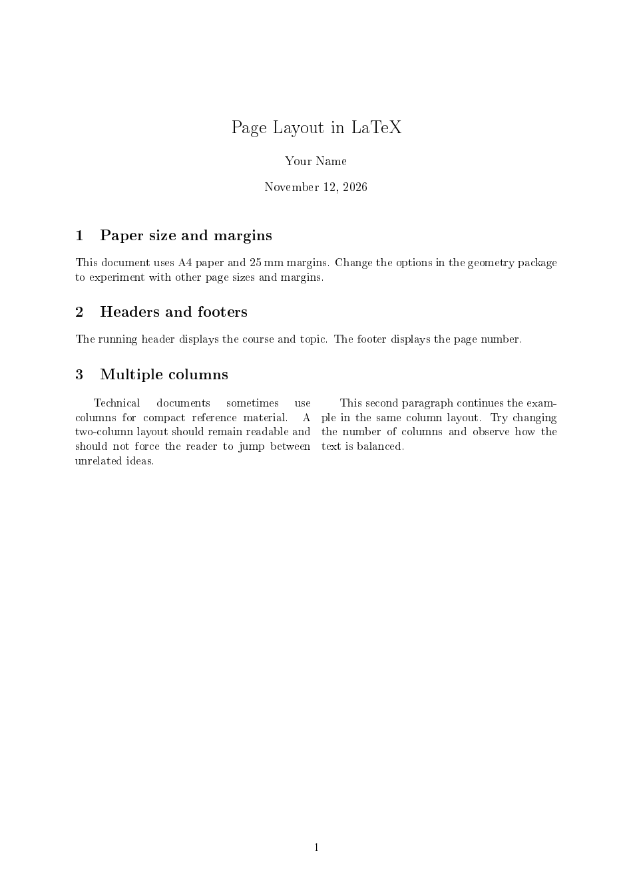
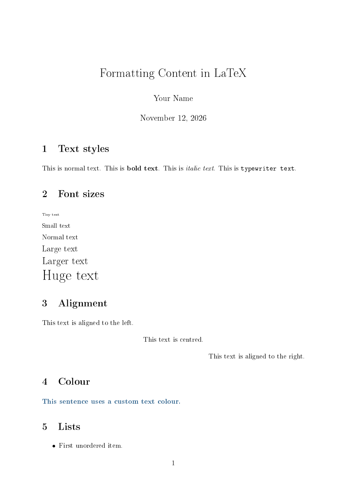
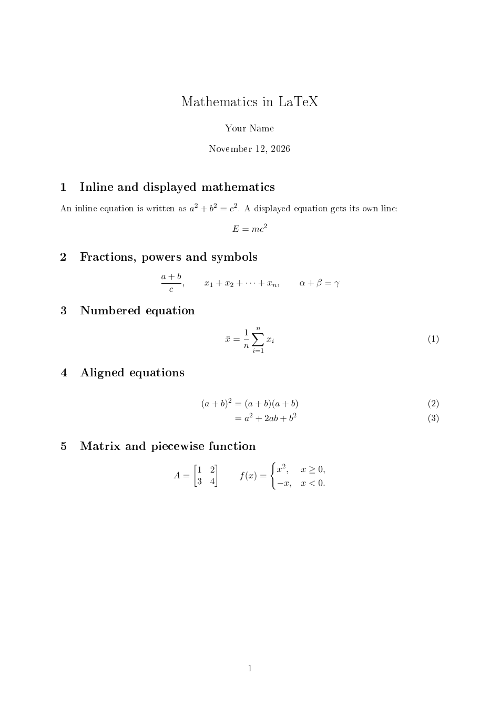
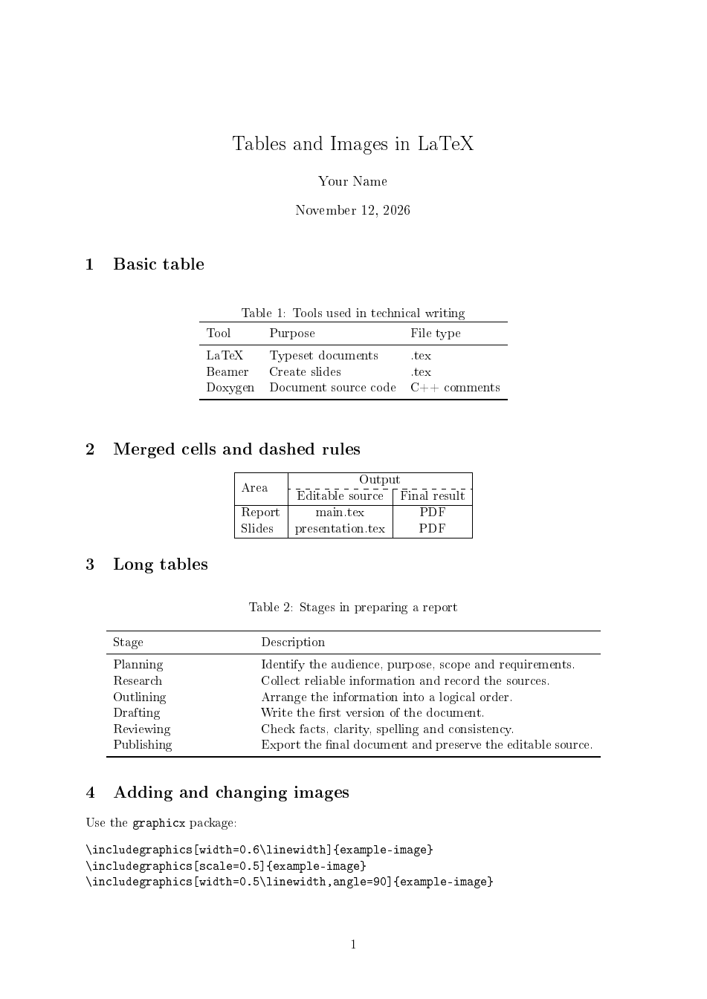
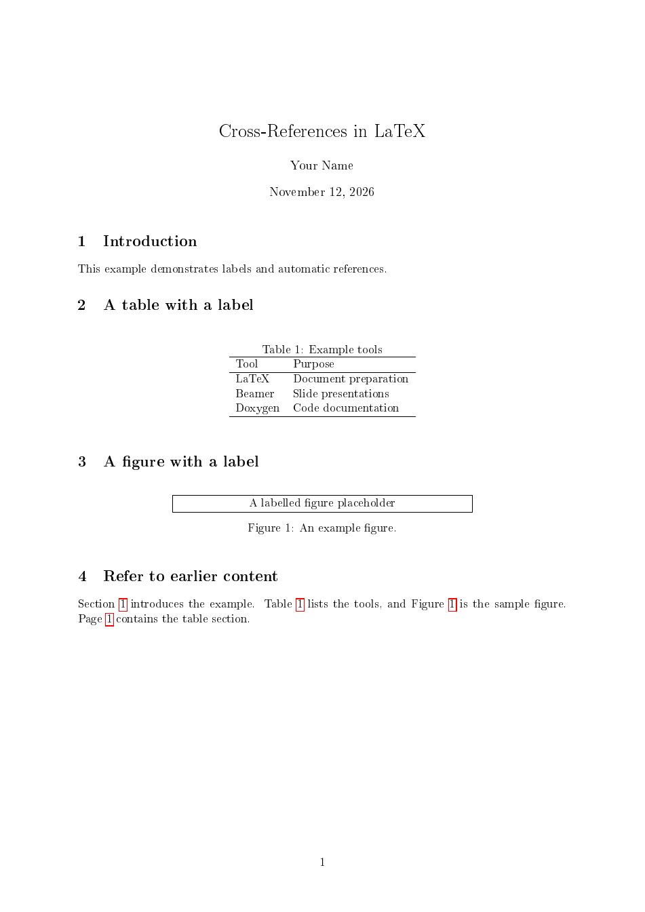
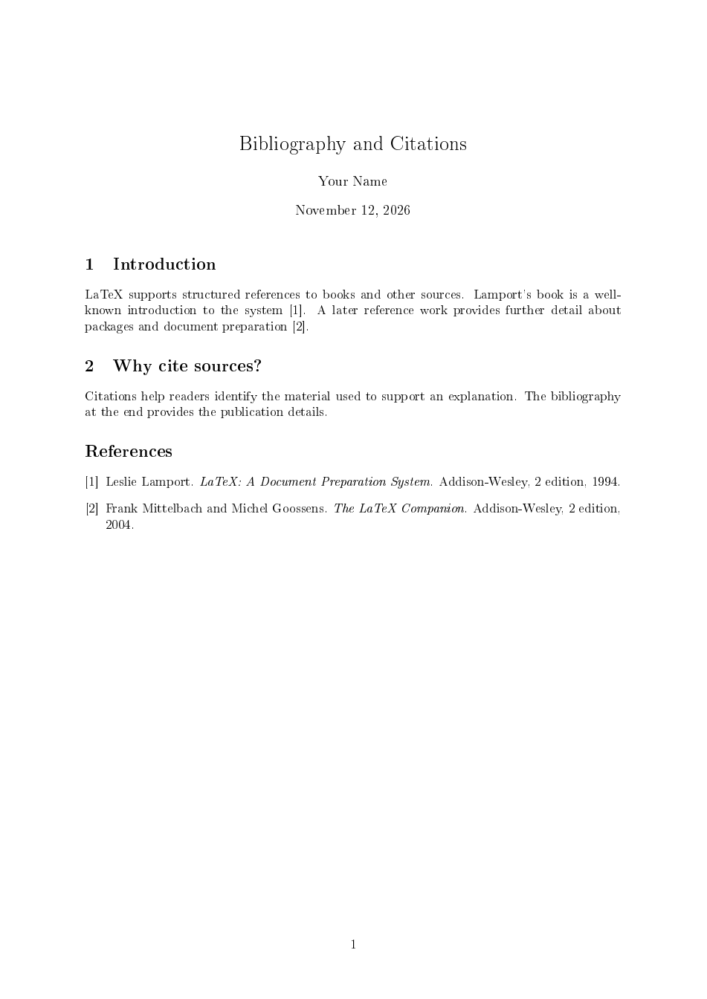
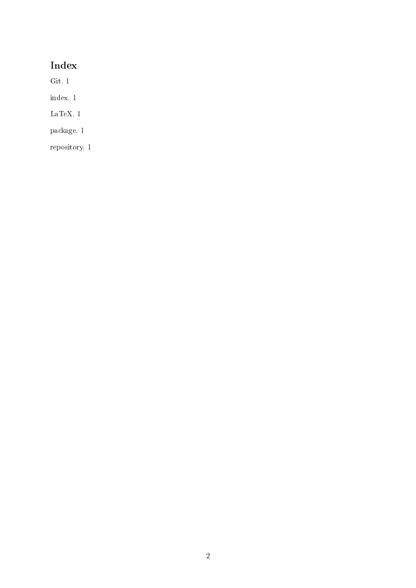

# 01 | LaTeX

> **Create well-structured technical and academic documents.**

---

## 01. What Is LaTeX?

LaTeX is a document preparation system. You write content and structure in a `.tex` source file, then compile it into a PDF. It is especially useful for long reports, mathematical notation, automatic numbering and references.

## 02. Installation and Editors

| Tool | What it provides |
|---|---|
| TeX Live / MacTeX | LaTeX distribution for Linux / macOS |
| MiKTeX | LaTeX distribution commonly used on Windows |
| Overleaf | Browser-based LaTeX editor and compiler |
| TeXstudio / TeXworks | Desktop editors |
| VS Code + LaTeX Workshop | Editor and LaTeX workflow extension |

An editor and a LaTeX distribution are different things. For local compilation, make sure the compiler and required packages are installed.

## 03. Explore the Eight Practical Examples

| No. | Topic | What you will practise |
|:---:|---|---|
| 01 | [First document](01-first-document/README.md) | Document class, preamble, packages, title and sections |
| 02 | [Page layout](02-page-layout/README.md) | Paper size, margins, headers, footers, orientation and columns |
| 03 | [Formatting](03-formatting/README.md) | Text styles, font sizes, alignment, colour and lists |
| 04 | [Mathematics](04-mathematics/README.md) | Equations, symbols, fractions, matrices and aligned expressions |
| 05 | [Tables and images](05-tables-and-images/README.md) | Tables, merged cells, dashed rules, long tables and image sizing |
| 06 | [Cross-references](06-cross-references/README.md) | Labels, references, numbering and page references |
| 07 | [Bibliography](07-bibliography/README.md) | Citations, BibTeX and reference lists |
| 08 | [Index](08-index/README.md) | Index entries, MakeIndex and printed index |

Every lesson has an editable `main.tex` file, a short explanation and a rendered output preview.

## 04. How to Compile an Example

Open the example folder in a terminal and run:

```bash
pdflatex main.tex
```

For the bibliography lesson, use the full build sequence in [07-bibliography](07-bibliography/README.md). For the index lesson, use the MakeIndex sequence in [08-index](08-index/README.md).

## 05. Common LaTeX Errors

| Error | What to check |
|---|---|
| Undefined control sequence | Command spelling and required package |
| Missing $ inserted | Math-mode delimiters |
| Missing } inserted | Unmatched braces |
| File not found | Image or input path |
| Citation undefined | Citation key and BibTeX build sequence |
| Reference undefined | Label spelling and another compile pass |
| Overfull hbox | Long text or a narrow page layout |

## 06. Rendered Examples

The previews below are rendered from the repository's `.tex` files using pdfLaTeX. They are actual document output previews, not fabricated Overleaf interface screenshots. To capture the Overleaf interface itself, open the same source file in your own Overleaf account.

| Lesson | Compiled output |
|---|---|
| First document |  |
| Page layout |  |
| Formatting |  |
| Mathematics |  |
| Tables and images |  |
| Cross-references |  |
| Bibliography |  |
| Index |  |

---

[Portfolio Home](../README.md) · [Next: Beamer](../02-Beamer/README.md)
