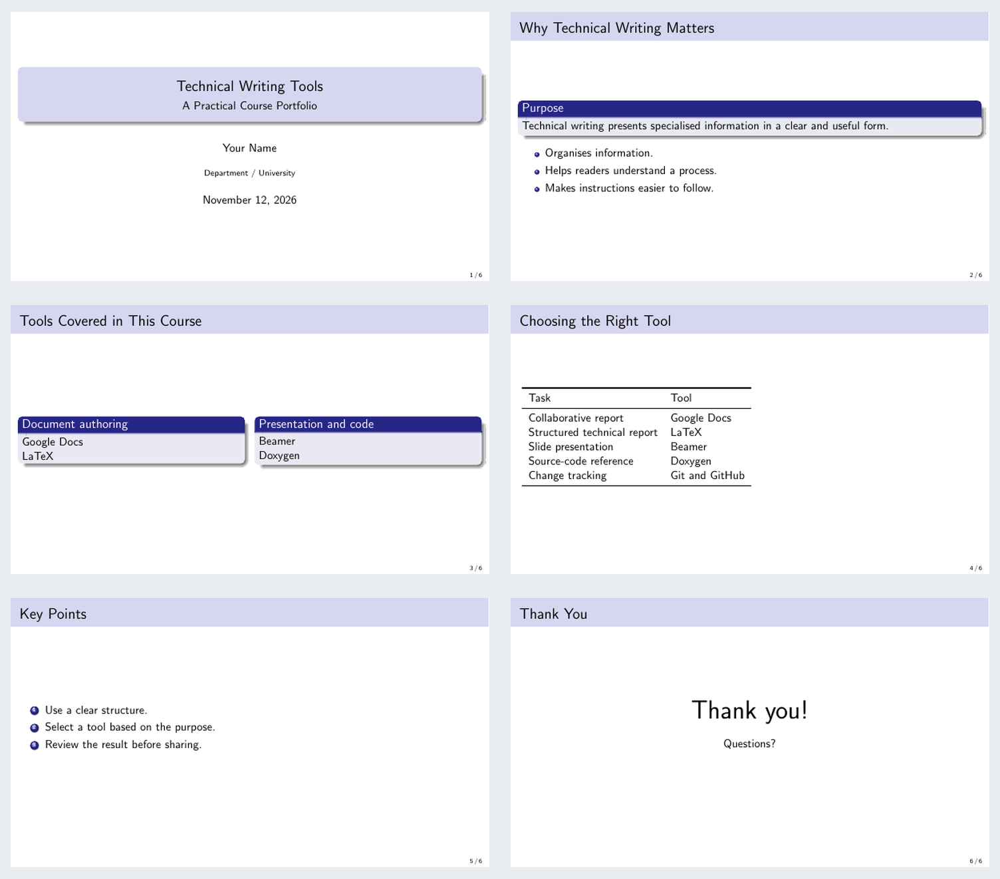

# 02 | Beamer

> **Turn your ideas into structured presentations.**

---

## 01. What Is Beamer?

Beamer is a LaTeX document class used to create presentation slides. You write structured LaTeX code and compile it into a PDF presentation.

**Why use Beamer?**

- Professional-looking slides.
- Mathematical equations and technical content.
- Consistent formatting across slides.
- Reusable themes and layouts.
- Integration with other LaTeX documents.

## 02. How Does It Work?

```text
LaTeX Beamer Code
       |
       v
  LaTeX Compiler
       |
       v
 Presentation PDF
```

A Beamer presentation is generally written inside the `frame` environment. One frame represents one slide.

## 03. Your First Presentation

```latex
\documentclass{beamer}
\usetheme{Madrid}

\title{Introduction to Beamer}
\author{Your Name}
\date{\today}

\begin{document}
\begin{frame}
  \titlepage
\end{frame}

\begin{frame}{Introduction}
  Beamer is used to create presentations
  using LaTeX.
\end{frame}
\end{document}
```

## 04. Important Commands

| Command | Purpose |
|---|---|
| `\documentclass{beamer}` | Selects Beamer |
| `\usetheme{Madrid}` | Applies a presentation theme |
| `\title{...}` | Defines the presentation title |
| `\author{...}` | Defines the author |
| `\begin{frame}` | Starts a slide |
| `\end{frame}` | Ends a slide |
| `\titlepage` | Displays the title slide |

## 05. Adding Content to Slides

**Bullet points**

```latex
\begin{frame}{Features of Beamer}
\begin{itemize}
  \item Structured slides
  \item Mathematical equations
  \item Customisable themes
\end{itemize}
\end{frame}
```

**Columns and blocks**

Use `columns` and `column` to divide a slide into multiple areas. Use `block`, `alertblock` and `exampleblock` to distinguish different types of content.

## 06. Themes and Appearance

| Theme | Style |
|---|---|
| Madrid | Structured and professional |
| Berlin | Navigation-oriented |
| Copenhagen | Compact and clean |
| CambridgeUS | Formal academic style |
| Warsaw | Distinctive header and footer |

You can also change colours using commands such as `\usecolortheme{seahorse}`.

## 07. Equations, Images and Overlays

Beamer supports mathematical environments and images through the same LaTeX commands used in reports. Overlays such as `\item<2->` reveal slide content gradually.

## 08. Compile the Presentation

```bash
pdflatex presentation.tex
pdflatex presentation.tex
```

Open `presentation.tex` in Overleaf or a desktop LaTeX editor to customise the author, institute and slide content.

## 09. See It in Action

The preview below shows slides compiled from this repository's `presentation.tex` file.



## 10. Common Errors

| Error | Solution |
|---|---|
| Missing frame environment | Close every `frame` |
| Image not displayed | Check the image path |
| Theme not applied | Check `\usetheme` spelling |
| Compilation error | Check braces and environments |
| Text overflowing | Reduce content or font size |

---

[Back: LaTeX](../01-LaTeX/README.md) · [Portfolio Home](../README.md) · [Next: Doxygen](../03-Doxygen/README.md)
