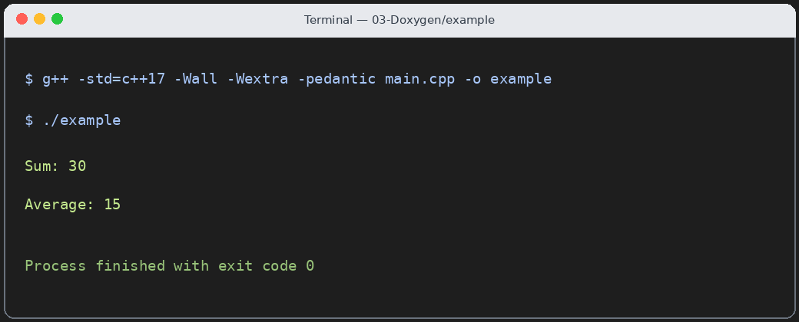

# 03 | Doxygen

> **Let your code explain itself.**

---

## 01. What Is Doxygen?

Doxygen is a documentation generation tool that extracts information from specially formatted comments in source code. It can generate HTML and LaTeX documentation.

**Why is it useful?**

- Explains functions, classes and variables.
- Makes large codebases easier to understand.
- Creates documentation from comments.
- Helps developers maintain and share projects.

## 02. How Does It Work?

```text
Source Code
    |
    v
Documentation Comments
    |
    v
  Doxygen
    |
    v
HTML / LaTeX Documentation
```

## 03. Writing Documentation Comments

Doxygen recognises special comment formats.

```cpp
/**
 * @brief Adds two integers.
 * @param first The first number.
 * @param second The second number.
 * @return The sum of the two numbers.
 */
int add(int first, int second) {
    return first + second;
}
```

## 04. Important Documentation Tags

| Tag | Purpose |
|---|---|
| `@brief` | Short description |
| `@param` | Describes a parameter |
| `@return` | Describes the return value |
| `@author` | Specifies the author |
| `@file` | Describes a file |
| `@class` | Documents a class |
| `@details` | Adds a detailed description |
| `@see` | Adds a related reference |
| `@note` | Adds a note |
| `@warning` | Adds a warning |

## 05. Generating Documentation

Install Doxygen and verify it:

```bash
doxygen --version
```

Generate a configuration file if you need a new one:

```bash
doxygen -g
```

Then run the configuration:

```bash
doxygen Doxyfile
```

Open the generated `html/index.html` file in a browser.

## 06. Practical C++ Example

The [example folder](example/) contains:

- `main.cpp` — functions documented with Doxygen-style comments.
- `Doxyfile` — settings that tell Doxygen what to scan and generate.

Build and run the C++ example:

```bash
cd example
g++ -std=c++17 -Wall -Wextra -pedantic main.cpp -o example
./example
```

Expected output:

```text
Sum: 30
Average: 15
```

## 07. See It in Action

The image shows the output from compiling and running the example program.



## 08. Common Errors

| Problem | Possible solution |
|---|---|
| No documentation generated | Check input paths |
| Comments not recognised | Use valid Doxygen comment syntax |
| Empty HTML output | Check configuration settings |
| Missing source files | Verify `INPUT` and `FILE_PATTERNS` |
| Command not found | Install Doxygen or check PATH |

---

[Back: Beamer](../02-Beamer/README.md) · [Portfolio Home](../README.md) · [Next: Google Docs](../04-Google-Docs/README.md)
