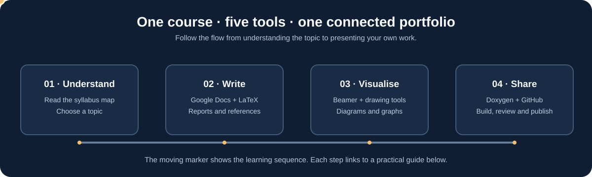
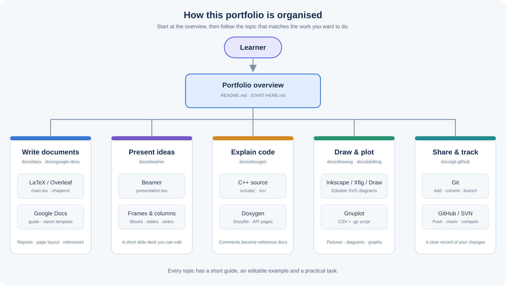
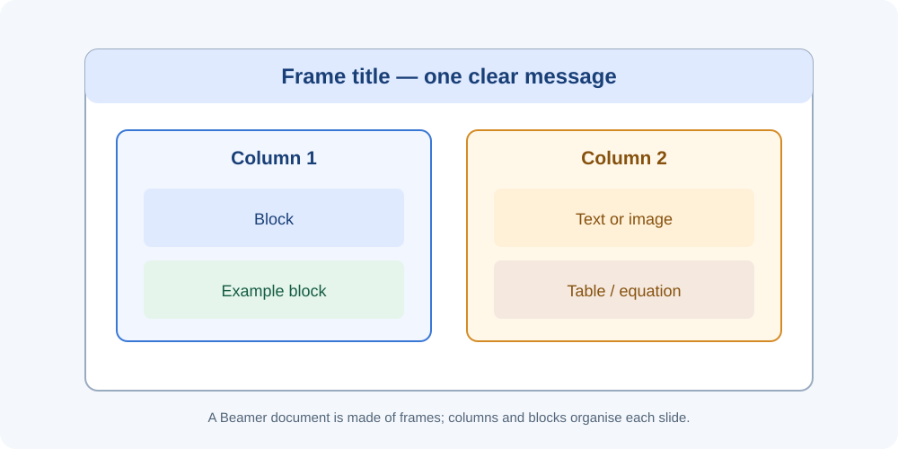
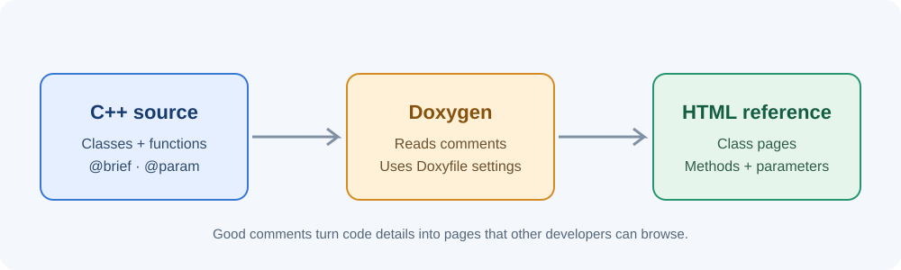
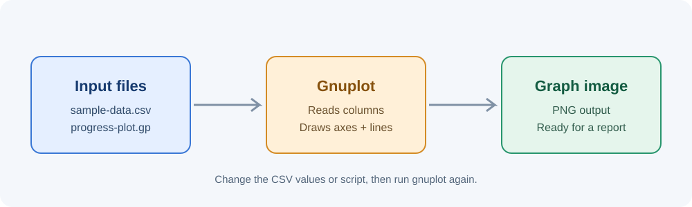
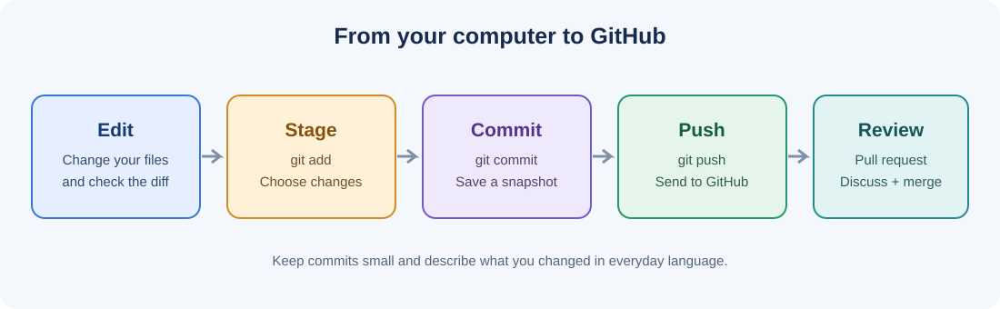

<div align="center">

# Technical Writing Portfolio

**A practical collection of the tools and techniques covered in my Technical Writing course.**

LaTeX · Google Docs · Doxygen · Beamer · Inkscape · Xfig · LibreOffice Draw · Gnuplot · Git · GitHub

<p>
  <a href="https://github.com/kushal-gajera/technical-writing-portfolio/actions/workflows/build-docs.yml"></a>
  
  
</p>



</div>

---

## Start here

New to this repository? Open **[docs/START-HERE.md](docs/START-HERE.md)**. It explains which file to open first for each topic and gives you a practical order to follow.

### Quick navigation

| I want to… | Open |
|---|---|
| See everything in the course outline | [Syllabus map](docs/syllabus-map.md) |
| Understand the folder structure | [Repository map](assets/repository-map.svg) |
| Make a report with LaTeX | [LaTeX guide](docs/latex/README.md) |
| Format a report in Google Docs | [Google Docs guide](docs/google-docs/guide.md) |
| Generate API documentation | [Doxygen guide](docs/doxygen/README.md) |
| Make presentation slides | [Beamer guide](docs/beamer/README.md) |
| Create diagrams | [Drawing guide](docs/drawing/README.md) |
| Plot a graph from data | [Gnuplot guide](docs/plotting/README.md) |
| Learn commits, branches and GitHub | [Git guide](docs/git-github/README.md) |

## How the repository is organised

This map shows how the main folders relate to the subjects in the course. You can open each guide directly from the links above.

<p align="center">
  
</p>

## What is included?

### 1. Document authoring

**LaTeX / Overleaf**

- A report split into manageable source files.
- Page size, margins, headers, footers, columns and landscape pages.
- Text formatting, lists and mathematical equations.
- Tables, merged cells, dashed rules, long tables and figures.
- Cross-references, bibliography and index.

[Open the LaTeX guide](docs/latex/README.md) · [Open the main source](docs/latex/main.tex)

**Google Docs**

- A practical report-formatting guide.
- Heading styles, automatic table of contents, page setup and page numbers.
- Tables, images, citations, comments and sharing.

[Open the Google Docs guide](docs/google-docs/guide.md) · [Open the report template](docs/google-docs/technical-report-template.md)

### 2. Presentations

**Beamer**

A sample slide deck that demonstrates frames, two-column layouts, blocks, lists, tables and equations.

<p align="center">
  
</p>

[Open the Beamer guide](docs/beamer/README.md) · [Edit presentation.tex](docs/beamer/presentation.tex)

### 3. Code documentation

**Doxygen**

A small C++ calculator with comments that explain classes, functions, parameters, return values and exceptions. Doxygen uses those comments to build HTML reference pages.

<p align="center">
  
</p>

[Open the Doxygen guide](docs/doxygen/README.md) · [Open calculator.hpp](docs/doxygen/include/calculator.hpp)

### 4. Drawing and graph plotting

**Inkscape, Xfig and LibreOffice Draw**

Editable SVG examples and exercises for alignment, grouping, connectors, labels and exporting diagrams.

[Open the drawing guide](docs/drawing/README.md) · [View the workflow diagram](assets/technical-writing-workflow.svg)

**Gnuplot**

A CSV dataset and plotting script that create a labelled progress graph.

<p align="center">
  
</p>

[Open the plotting guide](docs/plotting/README.md) · [Open the plotting script](docs/plotting/progress-plot.gp)

### 5. Version control and sharing

**Git, GitHub and SVN**

Learn the normal cycle: edit files, stage changes, commit a snapshot, push it to GitHub and review the result.

<p align="center">
  
</p>

[Open the Git guide](docs/git-github/README.md) · [Git command cheat sheet](docs/git-github/command-cheatsheet.md)

## Build the examples

You only need to install a tool when you want to run that section. From the repository root:

```bash
# Check that the important files are present
make check

# Compile the LaTeX report and Beamer slides
make latex
make slides

# Generate code documentation and a graph
make doxygen
make plot
```

See each topic guide for the exact requirements. GitHub Actions also runs the example build workflow when files are pushed to `main`.

## Before presenting this project

This repository is a practical course portfolio, not a substitute for your own lab work. Before showing it to your professor:

- Replace the sample student and department details.
- Run the examples and add screenshots of the outputs you made yourself.
- Write your own notes in [the learning journal](docs/learning-journal.md).
- Be prepared to explain what each tool does and how one example works.

---

<div align="center">

**Understand · Write · Visualise · Share**

</div>
