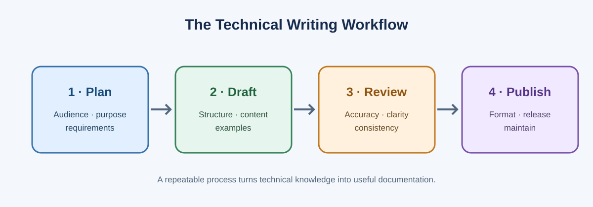

# Technical Writing Portfolio

<div align="center">

# TECHNICAL WRITING
### A practical course portfolio · Documentation · Typesetting · Visual communication · Version control

**LaTeX · Google Docs · Doxygen · Beamer · Inkscape / Xfig / Draw · Gnuplot · Git / GitHub / SVN**

*A syllabus-mapped, hands-on collection of reports, source files, diagrams, slides and workflows.*

</div>

---

## Welcome

This repository organises the major topics in a Technical Writing course into practical examples. A consistent theme—the lifecycle of a technical document—shows how documentation, visual communication, typesetting and collaboration tools fit together.

> **Student note:** This is a learning scaffold. Personalise student details, complete the learning journal, run the tools yourself, and add screenshots of your own work before submitting it as coursework.

## Course coverage

| Syllabus area | What is included | Where to look |
|---|---|---|
| Documentation tools | Doxygen, Google Docs, LaTeX / Overleaf | [Doxygen](docs/doxygen/README.md) · [Google Docs](docs/google-docs/guide.md) · [LaTeX](docs/latex/README.md) |
| Drawing software | Inkscape, Xfig, OpenOffice / LibreOffice Draw | [Drawing guide](docs/drawing/README.md) · [SVG assets](assets/) |
| Presentations | Beamer frames, columns, blocks and slide structure | [Beamer guide](docs/beamer/README.md) · [editable source](docs/beamer/presentation.tex) |
| Graph plotting | Gnuplot and CSV data | [Plotting guide](docs/plotting/README.md) |
| Version control | Git, GitHub and SVN | [Git & GitHub](docs/git-github/README.md) |
| LaTeX foundations | Installation, IDEs, article/book classes and sections | [LaTeX guide](docs/latex/README.md) |
| Page styling | Paper sizes, packages, margins, headers/footers, orientation and columns | [LaTeX source](docs/latex/main.tex) |
| Content formatting | Text styles, sizes, alignment, colour, lists and mathematics | [Formatting chapter](docs/latex/chapters/formatting.tex) |
| Tables and images | Borders, merged cells, long tables, scaling and rotation | [Tables & images chapter](docs/latex/chapters/tables-images.tex) |
| Referencing and indexing | Cross-references, bibliography and index | [References chapter](docs/latex/chapters/references-index.tex) |

## Repository map

```text
technical-writing-portfolio/
├── README.md
├── CONTRIBUTING.md
├── LICENSE
├── Makefile
├── .github/workflows/build-docs.yml
├── assets/                 # Editable SVG diagrams
├── docs/
│   ├── syllabus-map.md
│   ├── learning-journal.md
│   ├── latex/              # Report source, chapters and bibliography
│   ├── google-docs/        # Workflow guide and report template
│   ├── doxygen/            # C++ source, API comments and Doxyfile
│   ├── beamer/             # Editable presentation source
│   ├── drawing/            # Inkscape, Xfig and Draw exercises
│   ├── plotting/           # Gnuplot script and sample CSV
│   └── git-github/         # Git / GitHub guide and command cheat sheet
└── scripts/                # Structure validation
```

## Start here

1. Read the [syllabus coverage map](docs/syllabus-map.md).
2. Explore the [LaTeX report source](docs/latex/README.md).
3. Review the [Beamer presentation source](docs/beamer/README.md).
4. Generate API documentation using the [Doxygen project](docs/doxygen/README.md).
5. Practise diagrams with the [drawing guide](docs/drawing/README.md).
6. Run the [Gnuplot exercise](docs/plotting/README.md).
7. Learn the [Git / GitHub workflow](docs/git-github/README.md).
8. Record your own reflections in the [learning journal](docs/learning-journal.md).

## Visual overview



## Build and check

Install the tools needed for the outputs you want to generate: TeX Live, Doxygen, Graphviz and Gnuplot.

```bash
python3 scripts/check-structure.py
make check
make latex
make slides
make doxygen
make plot
```

A GitHub Actions workflow runs these checks and builds the LaTeX PDF, Beamer PDF, Doxygen HTML and Gnuplot image on pushes to `main`. The resulting files are available as the **technical-writing-builds** workflow artifact.

## Before academic submission

- Replace sample student name, department and date placeholders.
- Add screenshots of your own Google Docs, Doxygen, Inkscape / Draw and Gnuplot work.
- Complete the learning journal in your own words.
- Review your instructor's formatting and submission requirements.

---

<div align="center">

**Learn it · Document it · Visualise it · Version it**

</div>
