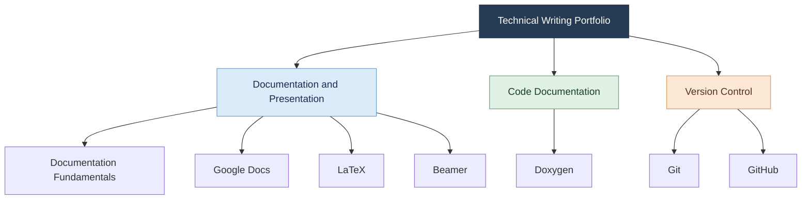

# Technical Writing Portfolio

**A structured, beginner-friendly portfolio of the tools and concepts covered in the Technical Writing course.**

Google Docs · LaTeX · Beamer · Doxygen · Git · GitHub

## Course map

## What this portfolio covers

| Area | Topics |
|---|---|
| Documentation fundamentals | Audience, purpose, structure, clarity and documentation workflow |
| Google Docs | Styles, page setup, headers and footers, columns, tables, images, comments, collaboration, version history and export |
| LaTeX | Installation and editors, document classes, packages, sections, margins, orientation, columns, formatting, colours, lists, mathematics, tables, merged cells, images, cross-references, bibliography and index |
| Beamer | Slides and frames, title pages, themes, columns, blocks, bullet points, tables and presentation structure |
| Doxygen | Structured source comments, documentation tags, configuration and generated HTML API documentation |
| Git | Repositories, staging, commits, history, branches, merging, remotes, push and pull |
| GitHub | Remote repositories, README files, collaboration, issues, pull requests and project sharing |

## Repository structure

- `01-documentation-fundamentals/` — principles and workflow for clear technical documentation
- `02-google-docs/` — Google Docs guides, formatting, collaboration and report template
- `03-latex/` — eight practical LaTeX examples, each with its own source and explanation
- `04-beamer/` — a complete sample presentation
- `05-doxygen/` — documented C++ example and Doxygen configuration
- `06-git-and-github/` — Git command reference and GitHub workflow
- `resources/` — official documentation and learning references

Each topic folder contains a README explaining the material and how to use its examples.

## Getting started

1. Open the README in the topic folder you want to study.
2. For Google Docs, follow the guide and copy the report outline into a new document.
3. For LaTeX, open one of the numbered example folders and compile its `main.tex`.
4. For the bibliography example, follow the build sequence in `03-latex/07-bibliography/README.md`.
5. For the index example, follow the build sequence in `03-latex/08-index/README.md`.
6. For Beamer, compile `04-beamer/presentation.tex`.
7. For Doxygen, run `doxygen Doxyfile` from `05-doxygen/example/`.
8. For Git and GitHub, follow the command examples in `06-git-and-github/`.

## Learning approach

Read the explanation, inspect the source or example, compile or run it where applicable, and then modify it to test your understanding. Replace placeholder names with your own details and add screenshots of your own practical work before submitting the portfolio.

## References

See [Resources and References](resources/references.md) for official documentation and recommended learning material.

## Contributing

See [CONTRIBUTING.md](CONTRIBUTING.md) for naming, testing and contribution guidelines.
