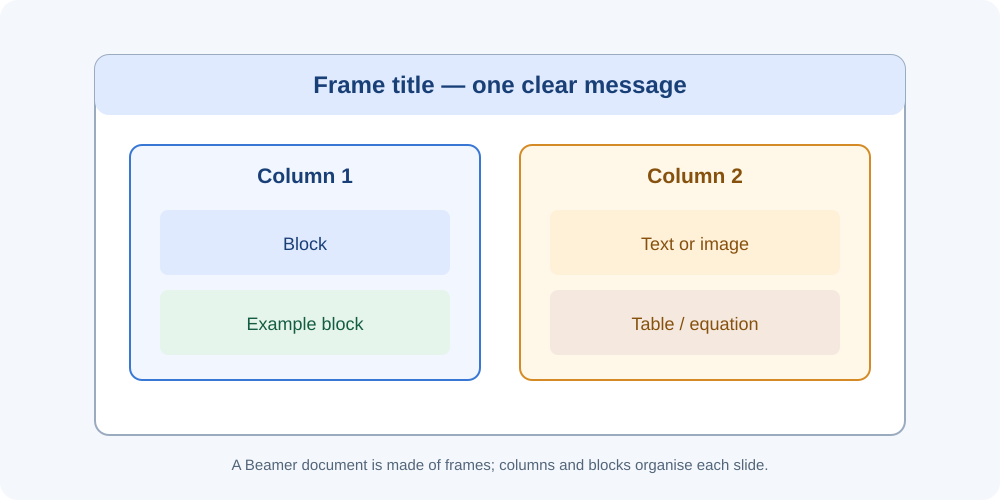

# Beamer — presentation slides

Beamer is a LaTeX document class for making slide presentations. A Beamer presentation is built from **frames**. Each frame can contain text, lists, tables, images, columns and blocks.



## Files to open

- `presentation.tex` — complete editable presentation source.
- The compiled PDF can be generated locally or through the repository's GitHub Actions build.

## Compile

```bash
cd docs/beamer
pdflatex presentation.tex
pdflatex presentation.tex
```

Or run `make slides` from the repository root.

## Important commands

| Command / environment | Purpose |
|---|---|
| `\begin{frame}...` | Creates one slide |
| `columns` and `column` | Divides a slide into columns |
| `block` | Highlights a definition or key point |
| `alertblock` | Highlights a warning or important point |
| `exampleblock` | Shows an example |
| `itemize` / `enumerate` | Creates bullet or numbered lists |

## Try it yourself

Add one frame with two columns. Put a definition in a block on the left and an example or picture on the right. Compile again and check that the text fits on the slide.
