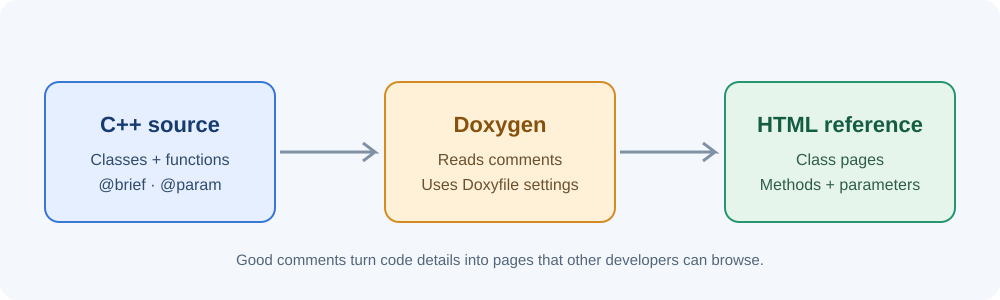

# Doxygen — source-code documentation

Doxygen reads structured comments in source code and creates a browsable API reference. The example in this folder documents a small C++ `Calculator` class.



## Files to open

- `include/calculator.hpp` — declarations and documentation comments.
- `src/calculator.cpp` — function implementations.
- `src/main.cpp` — a small program that uses the class.
- `Doxyfile` — settings used by Doxygen.

## Generate the HTML pages

Install Doxygen, then run:

```bash
cd docs/doxygen
doxygen --version
doxygen Doxyfile
```

Open `html/index.html` in a browser. The configuration turns on HTML output and source browsing.

## Comment tags used here

| Tag | What it explains |
|---|---|
| `@brief` | A short summary |
| `@param` | A function parameter |
| `@return` | The returned value |
| `@throws` | An exception that may be raised |
| `@file` | The purpose of a source file |

## Try it yourself

1. Add a square function to the calculator.
2. Write a short comment with its purpose and return value.
3. Run Doxygen again.
4. Open the generated class page and check that the new function appears.

You can compile the C++ example with:

```bash
g++ -std=c++17 -Wall -Wextra -pedantic -Iinclude src/calculator.cpp src/main.cpp -o calculator
./calculator
```
