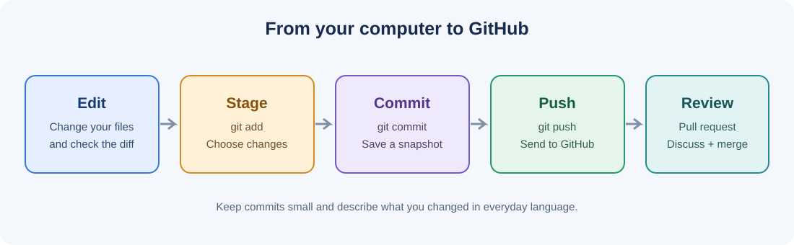

# Git and GitHub — track and share your work

Git records changes to files so that you can see what changed and return to earlier versions. GitHub hosts Git repositories and adds collaboration features such as pull requests and reviews. SVN (Subversion) is another version-control system that uses a centralised model.



## The everyday Git cycle

```bash
git status
git add .
git commit -m "Add examples to the report"
git push
```

- **status** shows which files changed.
- **add** selects which changes go into the next snapshot.
- **commit** saves the snapshot with a message.
- **push** sends your commits to GitHub.

## Make a branch

```bash
git switch -c add-report-examples
# edit and test your files
git add .
git commit -m "Add report examples"
git push -u origin add-report-examples
```

Open a pull request on GitHub to review the branch before merging.

## Git and SVN

| Git | SVN |
|---|---|
| Distributed: each clone has repository history. | Centralised: the central server is the main source of history. |
| A commit is saved locally first. | A commit is sent to the central repository. |
| Branches are lightweight and common. | Branches are commonly managed as repository paths. |

## A few useful commands

See [command-cheatsheet.md](command-cheatsheet.md) for the complete list. Never add passwords, API keys or access tokens to a repository.
