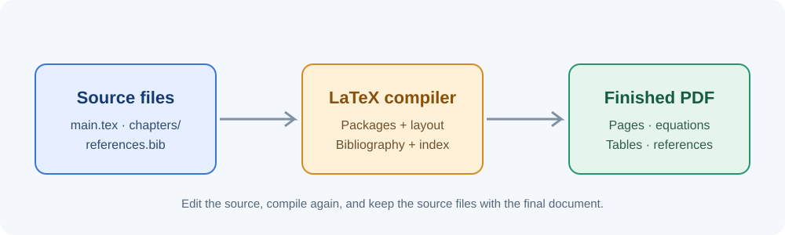

# LaTeX and Overleaf

LaTeX is a document preparation system. You write structured source in `.tex` files, then compile them into a PDF. It is especially useful for reports with equations, tables, cross-references and bibliographies.



## Files to open

- `main.tex` — main report file; it connects the sections.
- `chapters/formatting.tex` — text styles, alignment, lists and equations.
- `chapters/tables-images.tex` — tables, merged cells, long tables, and image commands.
- `chapters/references-index.tex` — cross-references, citations and index.
- `references.bib` — bibliography entries.

## Getting started

You can use **Overleaf** in a browser, or install a local distribution such as **TeX Live / MacTeX** or **MiKTeX**. Common editors include TeXstudio, TeXworks and VS Code with LaTeX Workshop.

## Compile the report

From this folder:

```bash
pdflatex main.tex
bibtex main
makeindex main.idx
pdflatex main.tex
pdflatex main.tex
```

Run LaTeX again after BibTeX and MakeIndex so the references and index appear correctly. In Overleaf, upload the folder while preserving the `chapters/` directory, set `main.tex` as the main file and recompile.

## Document classes

- `article` — assignments, papers and short reports.
- `report` — longer reports, usually with chapters.
- `book` — books and manuals with parts and chapters.

The supplied report uses `article`. Try changing the class to `report` or `book` and adjust the section structure.

## Common errors

| Message / symptom | What to check |
|---|---|
| Undefined control sequence | Command spelling and required package |
| Missing $ inserted | Math expression outside math mode |
| Missing } inserted | Unmatched braces |
| File not found | Image or input file path |
| Citation undefined | Citation key and BibTeX run |
| Label may have changed | Compile LaTeX again |
| Overfull hbox | Long text or a narrow layout |

## Try it yourself

Change the title and author, add a section, insert an equation, create a table, add a citation and index term, then compile the report again. Keep the editable `.tex` files with your PDF.
