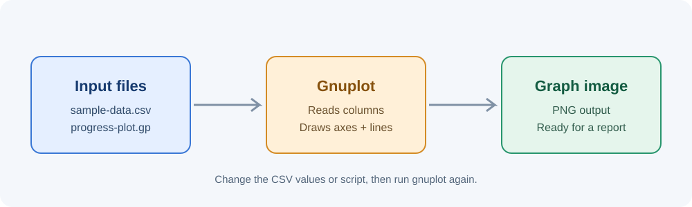

# Gnuplot — make a graph from data

Gnuplot is a graphing program that reads data files and produces plots. This example uses a small CSV file and a script so that you can change the data or the graph without drawing it by hand.



## Files to open

- `sample-data.csv` — the example data.
- `progress-plot.gp` — the commands that create the graph.

## Run the example

```bash
cd docs/plotting
gnuplot progress-plot.gp
```

The script creates `documentation-progress.png` in this folder.

## What the commands do

| Command | Purpose |
|---|---|
| `set datafile separator ","` | Reads a CSV file |
| `set terminal` | Selects the output format |
| `set output` | Sets the image filename |
| `set title` | Adds a graph title |
| `set xlabel` / `set ylabel` | Labels the axes |
| `plot` | Chooses columns and draws the data |

## Try it yourself

Change a value in the CSV file, run Gnuplot again and compare the new graph. Then change the title or axis labels. The supplied values are illustrative, not measured experimental results.
